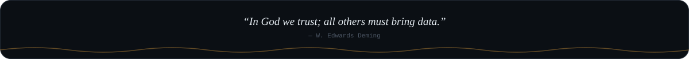

  

&nbsp;
&nbsp;
&nbsp;

  

<i>I build systems that have to be <b>right</b> — ledgers that reconcile to the cent, 
agents that cite their sources, fraud signals that fire before settlement — 
and then, for balance, things that are simply <b>fun</b>: pixel worlds, drum machines, running coaches.</i>

 

 

── &nbsp; S E L E C T E D &nbsp; W O R K &nbsp; ──

  
  

  
  

  
  

also in the crates →
<a href="https://github.com/mukesh132001/Emergency-Response-Data-Exploration">911 call forensics</a> ·
<a href="https://github.com/mukesh132001/mukesh132001.github.io">portfolio source</a> ·
<a href="https://github.com/mukesh132001/IrisVisionML">IrisVisionML</a> ·
<a href="https://github.com/mukesh132001/Fine_tune_food">Fine_tune_food</a> ·
<a href="https://github.com/mukesh132001/CSA-RISKV">CSA-RISKV</a>

 

── &nbsp; T O O L K I T &nbsp; ──

  

<b>+</b> &nbsp;dbt · Snowflake · Debezium · CrewAI · MCP · pgvector · Power BI · Tableau · Metabase · Web Audio

 

  

